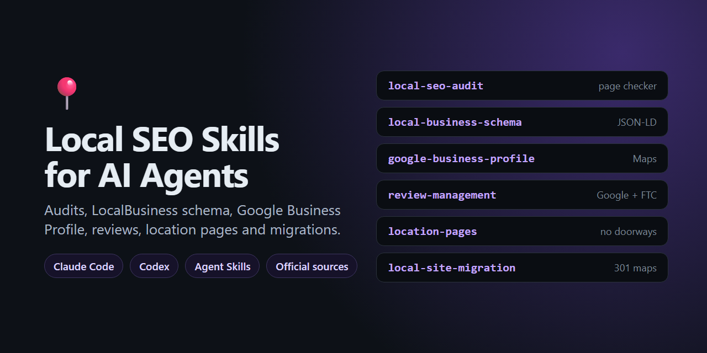

<div align="center">

# 📍 Local SEO Skills for AI Agents

**Teach Claude Code, Codex and other AI coding agents to do local SEO properly: audits, LocalBusiness schema, Google Business Profile, reviews, location pages and site migrations.**

Every rule is backed by an official Google or FTC source, so your agent doesn't invent SEO myths.

[](LICENSE)

-8A2BE2)




</div>

---

## Why

Local businesses (restaurants, plumbers, dentists, law firms, salons, stores) live or die by Google Maps and the local pack. General SEO skills for agents rarely cover the rules that matter here, and much of the local SEO advice online is out of date:

- Some of it recommends Google features that were **retired**, like Business Profile chat and business.site websites.
- Some of it recommends tactics that get profiles **suspended**, like keywords in the business name or virtual offices.
- Some of it recommends practices that are **illegal in the US** since October 2024, like review incentives and fake reviews.

These skills give your agent the current rules, with links to the pages they come from.

## The skills

| Skill | What your agent can do with it |
|---|---|
| [`local-seo-audit`](skills/local-seo-audit/SKILL.md) | Run a full local SEO audit with a bundled **zero-dependency page checker**, then report prioritized, evidence-backed fixes |
| [`local-business-schema`](skills/local-business-schema/SKILL.md) | Write and fix **LocalBusiness JSON-LD**: subtypes, opening-hours conventions, multiple locations, departments, common mistakes |
| [`google-business-profile`](skills/google-business-profile/SKILL.md) | Optimize a **Google Business Profile** within the guidelines: name, categories, service areas, practitioners, suspensions, retired features |
| [`review-management`](skills/review-management/SKILL.md) | Earn and reply to reviews within **Google policy and the FTC review rule**, with request and reply templates |
| [`location-pages`](skills/location-pages/SKILL.md) | Build city and location pages that rank **without being doorway pages** |
| [`local-site-migration`](skills/local-site-migration/SKILL.md) | **Redesign or move a site** without losing rankings: redirect maps, keeping local signals, launch checklist |

## Install

### Claude Code

```
/plugin marketplace add ahmettasdemirusa/local-seo-skills
/plugin install local-seo-skills@local-seo-skills
```

Or copy individual skill folders into `~/.claude/skills/` (all projects) or `.claude/skills/` (one project).

### Other agents (Codex, Cursor, Gemini CLI and more)

The skills use the open **Agent Skills** format: a folder with a `SKILL.md`. Copy the folders from [`skills/`](skills) to wherever your agent loads skills from, or point it at [`AGENTS.md`](AGENTS.md).

## Try it

Once the skills are installed, just ask:

> "Audit the local SEO of https://example-plumbing.com and tell me the top 3 fixes."
>
> "Write LocalBusiness schema for our dental clinic. We're closed Sundays and open until 8pm on Thursdays."
>
> "Can we give customers 10% off for leaving a Google review?" *(Your agent will explain why not, and what to do instead.)*
>
> "We serve 40 towns. Should we make a page for each one?"
>
> "We're moving from Wix to WordPress next month. What do we need to do so we don't lose our Google rankings?"

### The page checker on its own

The audit skill ships with `audit.py`, which also works as a standalone CLI (Python 3.8+, no packages):

```bash
python skills/local-seo-audit/scripts/audit.py https://example.com/ https://example.com/contact/
```

```
# Local SEO audit

**0 errors · 4 warnings · 3 tips** across 2 page(s).

## https://example.com/

HTTP 200 · 190 ms · schema: ProfessionalService

- ⚠️ schema · ProfessionalService: address has no `addressLocality`; Google asks for as many address properties as possible.
- ⚠️ schema · ProfessionalService: address has no `postalCode`; ...
- 💡 schema · ProfessionalService: no `geo` coordinates (recommended).
- 💡 nap · No link to or embed of a Google Maps listing.

## https://example.com/contact/

- ⚠️ schema · No LocalBusiness structured data found.
```

**It checks:**
- indexability: status, HTTPS, `noindex`, title, description, viewport, canonical, H1
- LocalBusiness JSON-LD against Google's rules: required properties, full address, phone format, 5-decimal coordinates, `priceRange` length, hours, self-serving reviews, the most specific type
- name/address/phone consistency on each page and across pages

Add `--json` for machine-readable output.

## Sources

Every rule in these skills comes from an official page, and each skill links the pages it relies on. The main ones:

- [Google: Local business structured data](https://developers.google.com/search/docs/appearance/structured-data/local-business)
- [Google: Review snippet guidelines](https://developers.google.com/search/docs/appearance/structured-data/review-snippet)
- [Google: Spam policies](https://developers.google.com/search/docs/essentials/spam-policies) (doorways, scaled content, keyword stuffing)
- [Google: Site moves with URL changes](https://developers.google.com/search/docs/crawling-indexing/site-move-with-url-changes)
- [Google Business Profile guidelines](https://support.google.com/business/answer/3038177) and [how local ranking works](https://support.google.com/business/answer/7091)
- [FTC: Consumer Reviews and Testimonials Rule Q&A](https://www.ftc.gov/business-guidance/resources/consumer-reviews-testimonials-rule-questions-answers)

The full list, with the date each page was checked, is in [SOURCES.md](SOURCES.md). Google changes these pages. If you spot something out of date, please [open an issue](https://github.com/ahmettasdemirusa/local-seo-skills/issues).

## Related

- 📍 [Local Business Schema Generator](https://github.com/ahmettasdemirusa/local-business-schema-generator): a free, in-browser editor that builds and validates LocalBusiness JSON-LD ([live demo](https://ahmettasdemirusa.github.io/local-business-schema-generator/)).

## Contributing

Pull requests are welcome, especially:
- rules for countries outside the US, e.g. consumer review laws in the UK, EU and Canada
- new checks for `audit.py`
- corrections backed by an official source

Run the tests with:

```bash
python -m unittest discover tests
```

## Disclaimer

These skills describe publicly documented platform rules and regulations. They are not legal advice. Businesses with legal questions about reviews or advertising should consult a lawyer.

## License

[MIT](LICENSE) © Ahmet Tasdemir

---

<div align="center">

If these skills help your agent, a ⭐ helps other people find them.

Built by **[Ahmet Tasdemir](https://github.com/ahmettasdemirusa)**, software engineer · [ahmettasdemir.com](https://ahmettasdemir.com)

More open source: 📍 [Local SEO toolkit](https://github.com/ahmettasdemirusa/local-seo-skills) · 🧊 [3D Web series](https://github.com/ahmettasdemirusa/spin360) · [all projects](https://github.com/ahmettasdemirusa)

</div>
